# Spring Boot 4에서 Flyway 직접 부딪혀 보기: migrate부터 repair, checksum, baseline까지

> Flyway를 처음 공부하면서 개념 문서를 먼저 읽기보다, 작은 도서 대여 도메인을 만들어 마이그레이션을 하나씩 쌓아 보고 **일부러 실패도 시켜 보면서** 정리한 기록입니다.

## 실습 환경

| 항목 | 버전 |
|---|---|
| Java | 17 |
| Spring Boot | 4.1.2 |
| Flyway | 12.4.0 (`spring-boot-starter-flyway`) |
| DB | H2 2.4.240 (file 모드) |

## Flyway를 쓰는 이유

이전에는 `schema.sql`과 `data.sql`을 `spring.sql.init`으로 실행했다. 이 방식은 매번 실행되기 때문에 `CREATE TABLE IF NOT EXISTS`, `WHERE NOT EXISTS` 같은 방어 코드가 필요했고, 무엇보다 **"컬럼 하나 추가"** 같은 변경 이력을 표현할 방법이 없었다.

Flyway는 스키마 변경을 **버전이 붙은 SQL 파일**로 관리한다.

- 파일 이름 규칙: `V<버전>__<설명>.sql` (언더스코어 **두 개**)
- DB 안의 `flyway_schema_history` 테이블에 어떤 버전이 언제 적용됐는지 기록한다.
- 앱이 시작될 때 이력에 없는 버전만 순서대로 실행한다.
- 이미 적용된 파일은 checksum이 저장되기 때문에 **수정하면 안 된다.**

## 실습 시나리오

| 버전 | 내용 | 배우는 것 |
|---|---|---|
| V1 | `CATEGORY`, `BOOK` 생성 + 초기 데이터 | migrate, 이력 테이블 |
| V2~V3 | `MEMBER` 생성, 회원/도서 데이터 | 버전이 쌓이는 흐름, 이름 규칙 검증 |
| V4~V5 | `LOAN` 생성(FK 2개), 대여 데이터 | DDL과 DML 분리 |
| V6~V7 | 일부러 실패시키기 | 실패한 마이그레이션, `repair` |
| (V1 수정) | 적용된 파일 수정 | checksum |
| V8~V12 | ISBN 컬럼 추가, FK 추가 | 데이터가 있는 테이블 변경 |
| R__ | 대여 현황 뷰 | 반복 실행(repeatable) 마이그레이션 |
| V13 | 컬럼 이름 변경 | R__의 약점 |
| legacy | 기존 DB에 도입 | `baseline` |
| 엔티티 | JPA `validate` + `@DataJpaTest` | 스키마와 엔티티 검증 |

---

## 1. 설정과 첫 마이그레이션

### 의존성

Spring Boot 4부터는 기능별 starter로 나뉘어 있어서 Flyway도 starter 하나만 추가하면 된다.

```kotlin
dependencies {
    implementation("org.springframework.boot:spring-boot-starter-data-jpa")
    implementation("org.springframework.boot:spring-boot-starter-flyway")
    runtimeOnly("com.h2database:h2")
}
```

### application.yml

```yaml
spring:
  datasource:
    url: jdbc:h2:file:./h2/db-migration;AUTO_SERVER=TRUE
    username: sa
    password:
  jpa:
    hibernate:
      ddl-auto: none        # 9단계에서 validate로 변경
  flyway:
    locations: classpath:db/h2
    enabled: true
```

기존 `spring.sql.init` 설정과 `schema.sql`, `data.sql`은 지웠다. 둘 다 앱 시작 시 SQL로 DB를 준비하는 기능이라, 같이 두면 스키마를 누가 책임지는지 헷갈리고 충돌할 수 있다.

### V1__init.sql

```sql
CREATE TABLE CATEGORY
(
    CODE          VARCHAR(50) PRIMARY KEY,
    NAME          VARCHAR(100) NOT NULL,
    DISPLAY_ORDER INT          NOT NULL
);

CREATE TABLE BOOK
(
    ID         BIGINT AUTO_INCREMENT PRIMARY KEY,
    TITLE      VARCHAR(255) NOT NULL,
    AUTHOR     VARCHAR(100) NOT NULL,
    CATEGORY   VARCHAR(50)  NOT NULL,
    CREATED_AT TIMESTAMP    NOT NULL DEFAULT CURRENT_TIMESTAMP
);

-- 기존 data.sql의 INSERT ... WHERE NOT EXISTS 를 그대로 옮김
```

`IF NOT EXISTS`는 뺐다. Flyway가 "한 번만 실행"을 보장하므로 필요 없고, 오히려 테이블이 예상과 다르게 이미 있는 상황을 조용히 넘겨 버린다. **마이그레이션은 실패해야 할 때 확실히 실패하는 게 좋다.**

### 첫 실행 로그

```
Schema history table "PUBLIC"."flyway_schema_history" does not exist yet
Successfully validated 1 migration
Creating Schema History table "PUBLIC"."flyway_schema_history" ...
Current version of schema "PUBLIC": << Empty Schema >>
Migrating schema "PUBLIC" to version "1 - init"
Successfully applied 1 migration to schema "PUBLIC", now at version v1
```

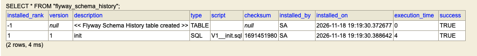

- `installed_rank = -1` 행은 이력 테이블을 만들었다는 표시다. 실제 마이그레이션이 아니라서 `version`이 null이다.
- `checksum`은 파일 내용으로 계산한 값이다. 5단계에서 이 값 때문에 오류를 만나게 된다.

### 재시작 로그

```
Successfully validated 1 migration
Current version of schema "PUBLIC": 1
Schema "PUBLIC" is up to date. No migration necessary.
```

Flyway는 시작할 때마다 **validate**(파일과 이력을 비교하고 checksum 확인)를 한 뒤 **migrate**(이력에 없는 버전만 실행)를 한다. V1은 이미 적용됐으니 `installed_on`도 그대로다.

### 함정: `.gitignore`가 마이그레이션 폴더를 삼켰다

DB 파일을 `./h2/`에 두면서 `.gitignore`에 `h2/`를 추가했는데, **push한 커밋에 `V1__init.sql`이 없었다.**

`h2/`는 모든 위치의 `h2` 폴더를 무시하기 때문에 마이그레이션 폴더인 `src/main/resources/db/h2/`까지 무시된 것이다. 로컬에는 파일이 있으니 앱이 잘 뜨지만, 다른 사람이 받으면 Flyway가 마이그레이션을 하나도 찾지 못한다.

```gitignore
### H2 Database ###
/h2/    # 루트 기준으로만 무시
```

---

## 2. 버전 쌓기와 이름 규칙 검증

```sql
-- V2__create_member.sql
CREATE TABLE MEMBER
(
    ID         BIGINT AUTO_INCREMENT PRIMARY KEY,
    NAME       VARCHAR(100) NOT NULL,
    EMAIL      VARCHAR(255) NOT NULL UNIQUE,
    CREATED_AT TIMESTAMP    NOT NULL DEFAULT CURRENT_TIMESTAMP
);
```

```sql
-- V3__insert_seed_data.sql
INSERT INTO MEMBER (NAME, EMAIL) VALUES ('김영희', 'younghee@example.com');
INSERT INTO MEMBER (NAME, EMAIL) VALUES ('이철수', 'cheolsu@example.com');

-- 1권은 CATEGORY에 없는 'COMIC' (6단계 FK 실험용)
INSERT INTO BOOK (TITLE, AUTHOR, CATEGORY) VALUES ('데미안', '헤르만 헤세', 'NOVEL');
INSERT INTO BOOK (TITLE, AUTHOR, CATEGORY) VALUES ('원피스', '오다 에이이치로', 'COMIC');
```

V2와 V3를 한 번에 추가하고 실행했다.

```
Current version of schema "PUBLIC": 1
Migrating schema "PUBLIC" to version "2 - create member"
Migrating schema "PUBLIC" to version "3 - insert seed data"
Successfully applied 2 migrations to schema "PUBLIC", now at version v3
```

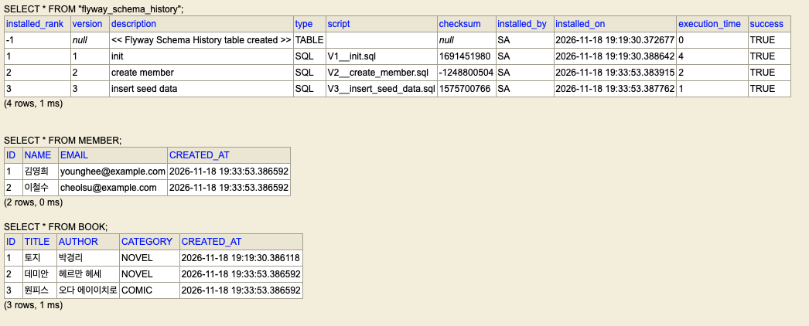

- 대기 중인 버전을 **버전 순서대로** 실행한다.
- 기본 설정에서는 마이그레이션마다 **각자의 트랜잭션**으로 실행된다.
- FK가 없으니 `'COMIC'` 도서도 문제없이 들어갔다.

### 이름을 틀리면? 실행되지 않고 "무시"된다

`V4_test.sql`처럼 언더스코어를 **하나만** 쓴 파일을 넣어 봤다. 앱은 아무 문제 없이 떴는데, 이력에는 V4가 없었다. **Flyway는 이름 규칙에 맞지 않는 파일을 기본적으로 조용히 건너뛴다.**

개발자는 마이그레이션을 추가했다고 생각하지만 실제로는 아무것도 반영되지 않는, 꽤 위험한 기본값이다. 다음 설정으로 막을 수 있다.

```yaml
spring:
  flyway:
    validate-migration-naming: true
```

```
Error creating bean with name 'flywayInitializer' ... Invalid SQL filenames found:
```

이제는 이름이 틀린 파일이 있으면 **앱 시작이 실패**한다. 켜 두는 게 안전하다.

---

## 3. 대여 테이블과 FK, 그리고 첫 실패

테이블 생성(V4)과 데이터 입력(V5)은 일부러 나눴다. **버전 하나에 목적 하나.**

```sql
-- V4__create_loan.sql
CREATE TABLE LOAN
(
    ID          BIGINT AUTO_INCREMENT PRIMARY KEY,
    BOOK_ID     BIGINT    NOT NULL,
    MEMBER_ID   BIGINT    NOT NULL,
    LOANED_AT   TIMESTAMP NOT NULL DEFAULT CURRENT_TIMESTAMP,
    DUE_AT      TIMESTAMP NOT NULL,
    RETURNED_AT TIMESTAMP,
    CONSTRAINT FK_LOAN_BOOK FOREIGN KEY (BOOK_ID) REFERENCES BOOK (ID),
    CONSTRAINT FK_LOAN_MEMBER FOREIGN KEY (MEMBER_ID) REFERENCES MEMBER (ID)
);
```

```sql
-- V5__insert_loan_data.sql
INSERT INTO LOAN (BOOK_ID, MEMBER_ID, DUE_AT)
VALUES (1, 1, DATEADD('DAY', 14, CURRENT_TIMESTAMP));
```

FK에는 `FK_LOAN_BOOK`처럼 **이름을 붙였다.** 이름이 없으면 DB가 임의로 붙여서, 나중에 이 제약을 지우거나 바꾸는 마이그레이션을 쓰기 어렵다.

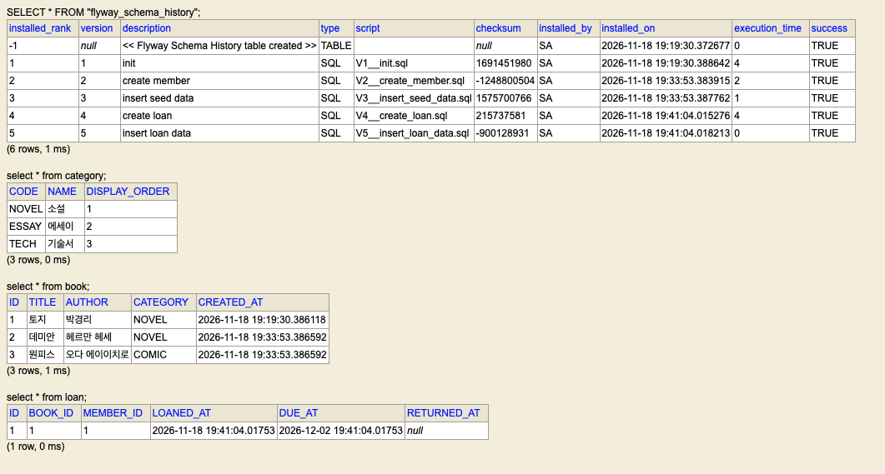

### 없는 도서로 대여하기 (V6)

```sql
-- V6__wrong_data.sql
INSERT INTO LOAN (BOOK_ID, MEMBER_ID, DUE_AT)
VALUES (999, 1, DATEADD('DAY', 14, CURRENT_TIMESTAMP));
```

```
JdbcSQLIntegrityConstraintViolationException: Referential integrity constraint violation:
"FK_LOAN_BOOK: PUBLIC.LOAN FOREIGN KEY(BOOK_ID) REFERENCES PUBLIC.BOOK(ID) (CAST(999 AS BIGINT))"
```

앱이 뜨지 않으니 H2 콘솔도 쓸 수 없었다. 이럴 땐 `spring.flyway.enabled: false`로 잠깐 띄우거나, IDE의 DB 도구로 같은 URL에 직접 접속하면 된다(`AUTO_SERVER=TRUE`).

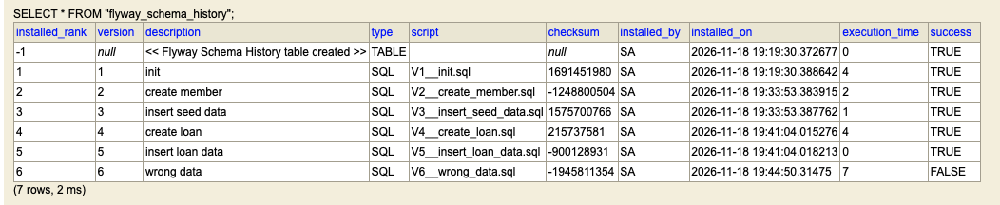

**이력에 `success = FALSE`가 남았다.** Flyway는 H2를 "DDL을 트랜잭션으로 롤백할 수 없는 DB"로 취급한다. 그래서 실패하면 중간까지 적용됐을 수도 있다고 보고, 사람이 확인하라는 표시로 실패 행을 남긴다. PostgreSQL처럼 DDL도 롤백되는 DB에서는 통째로 롤백되고 이력에도 남지 않는다.

### V6 파일을 지우면?

```
WARN Schema "PUBLIC" has a version (6) that is newer than the latest available migration (5) !
WARN Schema "PUBLIC" contains a failed future migration to version 6 !
INFO Schema "PUBLIC" is up to date. No migration necessary.
```

이력에는 V6이 있는데 파일은 V5까지뿐이라 Flyway는 이걸 **"미래 버전"**으로 본다. 경고만 찍고 앱은 뜨지만, DB는 여전히 "V6 실패" 상태로 남아 있다.

---

## 4. 실패한 마이그레이션 복구하기: repair

`BOOK_ID`를 올바르게 고친 새 V6을 만들고 실행하면 막힌다.

```sql
-- V6__wrong_data_repair.sql
INSERT INTO LOAN (BOOK_ID, MEMBER_ID, DUE_AT)
VALUES (2, 2, DATEADD('DAY', 14, CURRENT_TIMESTAMP));
```

```
Validate failed: Migrations have failed validation
Detected failed migration to version 6 (wrong data).
Please remove any half-completed changes then run repair to fix the schema history.
```

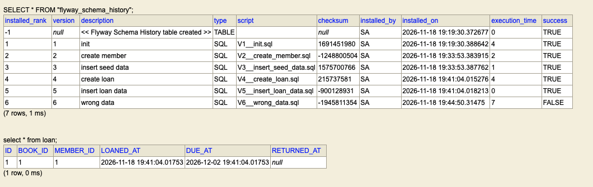

오류 메시지가 복구 순서를 알려 준다. **① 반쯤 적용된 변경을 직접 정리하고 → ② repair.**

Spring Boot에는 repair 명령이 없어서, 시작할 때 Flyway가 하는 일을 잠깐 바꿨다.

```java
@Configuration
public class FlywayRepairConfig {

    @Bean
    FlywayMigrationStrategy repairThenMigrate() {
        return flyway -> {
            flyway.repair();
            flyway.migrate();
        };
    }
}
```

Spring Boot 4에서는 import 경로가 `org.springframework.boot.flyway.autoconfigure.FlywayMigrationStrategy`로 바뀌었다.

```
Successfully repaired schema history table "PUBLIC"."flyway_schema_history"
Manual cleanup of the remaining effects of the failed migration may still be required.
Current version of schema "PUBLIC": 5
Migrating schema "PUBLIC" to version "6 - wrong data repair"
Successfully applied 1 migration to schema "PUBLIC", now at version v6
```

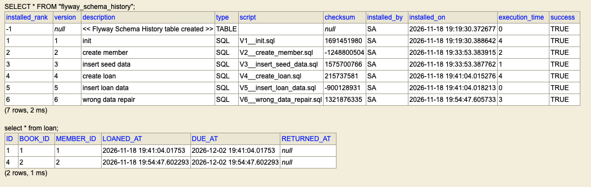

- 실패한 V6 행이 사라지고 `Current version`이 5로 돌아간 뒤, 새 V6이 적용됐다.
- `Manual cleanup ... may still be required`: repair는 **이력만 고치고 DB 내용은 건드리지 않는다.**
- `LOAN.ID`가 1 다음에 **4**다. 실패한 INSERT들이 자동 증가 값을 이미 써 버렸고, 이 값은 롤백되지 않는다. ID가 연속이라고 가정하면 안 된다.

### 중간까지 적용된 실패 (V7)

테이블 생성과 실패하는 INSERT를 한 파일에 넣어 봤다.

```sql
-- V7__partial_fail.sql (실패 버전)
CREATE TABLE BOOK_GROUP ( ... );
-- 일부러 실패하는 INSERT
```

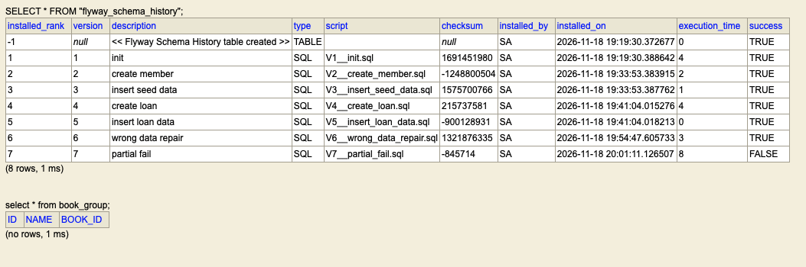

이력은 `FALSE`인데 **`BOOK_GROUP` 테이블은 남았다.** H2에서는 DDL이 자동 커밋되기 때문이다. 이 상태에서 INSERT만 고쳐서 다시 돌리면 "테이블이 이미 있다"며 또 실패한다.

처음에는 V7에만 `IF NOT EXISTS`를 붙여야 하나 생각했는데, 그건 답이 아니다.

- 이 문제는 **내 로컬 DB에만** 있다. 다른 환경에서는 V7이 처음 실행되니 테이블이 없다.
- 남은 테이블이 의도와 다른 구조일 수도 있는데, `IF NOT EXISTS`는 그걸 그냥 통과시킨다.

**마이그레이션 파일이 아니라 DB를 고쳐야 한다.**

```sql
DROP TABLE BOOK_GROUP;  -- 1) 남은 흔적 직접 정리
```

2) 실패한 V7의 INSERT 수정 → 3) repair → migrate

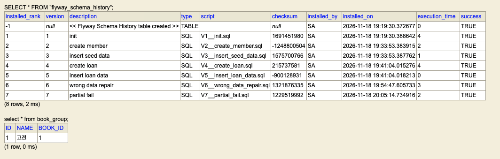

V7의 checksum이 실패 때와 달라졌지만 문제없다. 실패한 행은 repair가 지웠기 때문이다. **실패한 마이그레이션은 고쳐도 되고, 성공한 마이그레이션은 고치면 안 된다.**

### 배운 점

- H2나 MySQL처럼 DDL이 자동 커밋되는 DB에서는 **한 마이그레이션에 DDL과 DML을 섞지 말자.** V4/V5처럼 나누면 실패해도 남는 흔적이 거의 없다.
- **repair를 항상 켜 두면 안 된다.** 실행할 때마다 실패 기록을 지우고 checksum을 파일에 맞춰 버리니, Flyway의 안전장치를 끄는 셈이다. 쓰고 나면 바로 지우자.
- 이력 테이블을 직접 `DELETE`하는 대신 repair를 쓰는 이유: 실패 행 삭제, checksum·설명 재정렬, 사라진 마이그레이션 표시까지 **이력을 일관되게** 정리해 준다.

---

## 5. 이미 적용된 파일을 고치면? checksum

V1에 남아 있던 불필요한 `WHERE NOT EXISTS`를 지워 단순한 INSERT로 바꿨다. 결과는 같으니 "무해한 정리"처럼 보인다.

```
Validate failed: Migrations have failed validation
Migration checksum mismatch for migration version 1
-> Applied to database : 1691451980
-> Resolved locally    : 80332334
Either revert the changes to the migration, or run repair to update the schema history.
```

데이터가 같아도 Flyway는 **파일 내용**만 본다. 주석이나 공백 한 글자도 checksum을 바꾼다.

| 방법 | 결과 |
|---|---|
| A. 파일 되돌리기 | checksum이 다시 일치, 아무 일도 없음 (가장 안전) |
| B. 수정한 채 repair | 이력의 checksum만 `80332334`로 바뀜, SQL은 재실행되지 않음 |

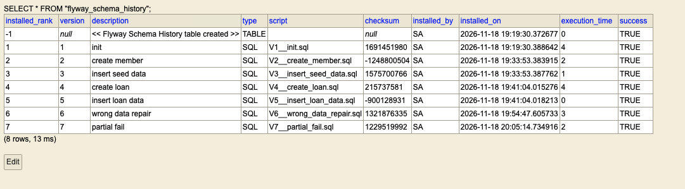

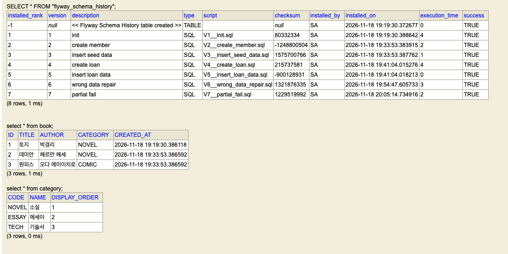

### 수정한 V1을 커밋하면 다른 환경은?

처음에는 "다른 환경도 같이 바뀌는데 이력만 안 남는 건가?"라고 생각했는데, 그렇지 않다.

- 이미 V1이 적용된 DB에서는 **V1이 다시 실행되지 않는다.**
- 대신 그 DB 이력에는 옛 checksum이 있으니 **validate가 실패하고 앱이 뜨지 않는다.**
- V1에 컬럼 추가 같은 의미 있는 변경을 넣었다면, 새 DB에는 컬럼이 생기고 기존 DB에는 영영 생기지 않는다. **환경마다 스키마가 다른데 이력은 둘 다 "V1 완료"인** 최악의 상태가 된다.

**적용된 마이그레이션은 절대 고치지 않고, 바꾸고 싶은 건 새 버전으로 추가한다.** 예외는 아직 push하지 않아 나만 적용한 마이그레이션 정도다.

---

## 6. 데이터가 있는 테이블 바꾸기: 컬럼 추가와 FK

```sql
-- V8__add_book_isbn.sql
ALTER TABLE BOOK ADD COLUMN ISBN VARCHAR(20);
```

```sql
-- V9__fill_book_isbn.sql
UPDATE BOOK SET ISBN = '978-89-374-6001-0' WHERE TITLE = '토지';
UPDATE BOOK SET ISBN = '978-89-329-1156-5' WHERE TITLE = '데미안';
UPDATE BOOK SET ISBN = '978-4-08-873621-5' WHERE TITLE = '원피스';
```

```sql
-- V10__set_book_isbn_not_null.sql
ALTER TABLE BOOK ALTER COLUMN ISBN SET NOT NULL;
```

처음부터 `NOT NULL`로 추가하면 기존 행 때문에 실패한다. **추가(NULL 허용) → 값 채우기 → 제약 걸기**가 정석 순서다. 실제 무중단 배포라면 이 세 단계를 여러 번의 배포에 나눠서 진행한다.

FK를 걸기 전에 `'COMIC'` 도서 문제를 먼저 해결했다. 원피스의 카테고리를 바꾸는 대신, 실제로 만화이니 카테고리를 추가하는 게 비즈니스적으로 맞다고 판단했다.

```sql
-- V11__add_category_comic.sql
INSERT INTO CATEGORY (CODE, NAME, DISPLAY_ORDER) VALUES ('COMIC', '만화', 4);
```

```sql
-- V12__add_fk_book_category.sql
ALTER TABLE BOOK ADD CONSTRAINT FK_BOOK_CATEGORY FOREIGN KEY (CATEGORY) REFERENCES CATEGORY (CODE);
```

```
Current version of schema "PUBLIC": 7
Migrating schema "PUBLIC" to version "8 - add book isbn"
Migrating schema "PUBLIC" to version "9 - fill book isbn"
Migrating schema "PUBLIC" to version "10 - set book isbn not null"
Migrating schema "PUBLIC" to version "11 - add category comic"
Migrating schema "PUBLIC" to version "12 - add fk book category"
Successfully applied 5 migrations to schema "PUBLIC", now at version v12
```

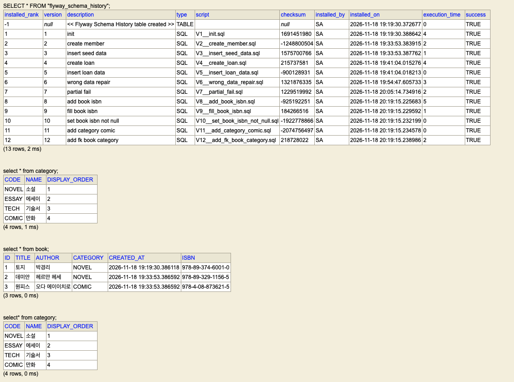

### 아쉬운 점: `WHERE TITLE = ...`

V9은 제목으로 행을 찾는다. 제목은 고유하지 않고, 무엇보다 **환경마다 데이터가 다르다.** 운영 DB에 '토지'가 없으면 UPDATE는 0건을 바꾸고 조용히 성공한 뒤, 다음 V10의 `NOT NULL`에서 실패한다. 데이터 마이그레이션은 고유 키로 조건을 걸고, 남은 행을 채우는 문장(`... WHERE ISBN IS NULL`)을 함께 둬서 **어떤 환경에서도 통과하게** 쓰는 게 좋다.

### 실패한 버전 번호는 재사용해도 될까?

- H2에서 실패한 버전은 repair하면 이력에서 사라지고, PostgreSQL에서는 처음부터 기록되지 않는다.
- 그래서 **실패한 번호는 다시 써도 된다.**
- 기준은 하나다. **어느 환경에서든 성공한 적이 있는 번호는 절대 재사용하거나 수정하지 않는다.**

---

## 7. 반복 실행 마이그레이션 (R__)

뷰, 함수, 프로시저처럼 "현재 정의로 통째로 교체"하는 객체는 `R__`로 관리한다.

```sql
-- R__loan_status_view.sql (최초 버전)
CREATE OR REPLACE VIEW LOAN_STATUS AS
SELECT M.NAME       AS MEMBER_NAME,
       B.TITLE      AS BOOK_TITLE,
       L.LOANED_AT,
       L.DUE_AT,
       CASE WHEN L.RETURNED_AT IS NOT NULL THEN 'Y' ELSE 'N' END AS RETURNED
FROM LOAN L
         JOIN MEMBER M ON L.MEMBER_ID = M.ID
         JOIN BOOK B ON L.BOOK_ID = B.ID;
```

```
Current version of schema "PUBLIC": 12
Migrating schema "PUBLIC" with repeatable migration "loan status view"
Successfully applied 1 migration to schema "PUBLIC"
```

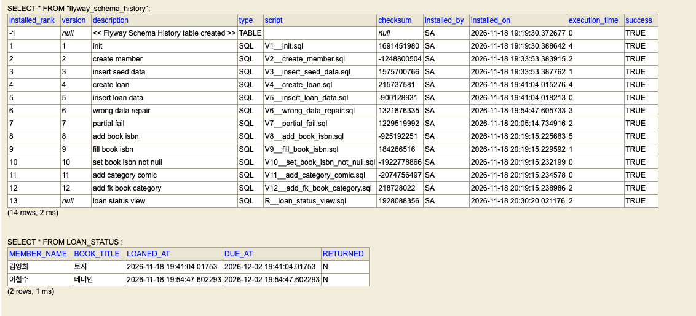

- `version`은 null, `installed_rank`는 이어서 13이다.
- `Current version`은 **계속 12**다. R__은 스키마 버전에 영향을 주지 않는다.

**재시작하면?** 다시 실행되지 않는다. R__은 매번 실행되는 게 아니라 **checksum이 바뀔 때만** 실행된다.

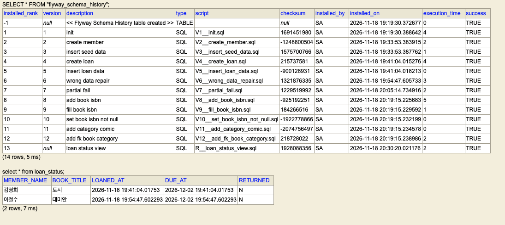

**뷰에 `RETURNED_AT` 컬럼을 추가하면?** V__와 달리 오류 없이 다시 실행되고, 이력에 **새 행이 추가**된다. 두 번째 실행 때는 뷰가 이미 있으니 `CREATE OR REPLACE`가 필요하다.

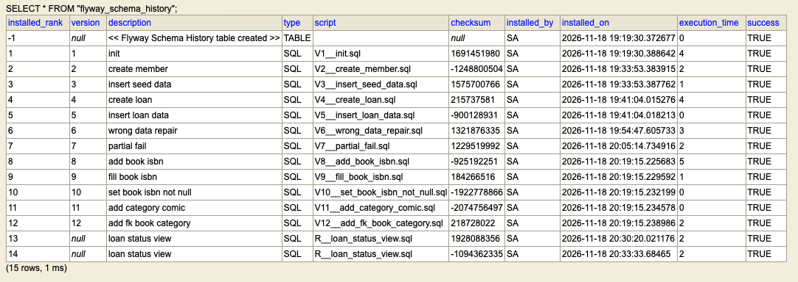

**V와 R이 같이 있으면?** 대기 중인 V__를 모두 실행한 뒤 R__을 실행한다.

### R__의 약점: 의존하는 테이블이 바뀌어도 모른다

```sql
-- V13__rename_member_name.sql
ALTER TABLE MEMBER ALTER COLUMN NAME RENAME TO MEMBER_NAME;
```

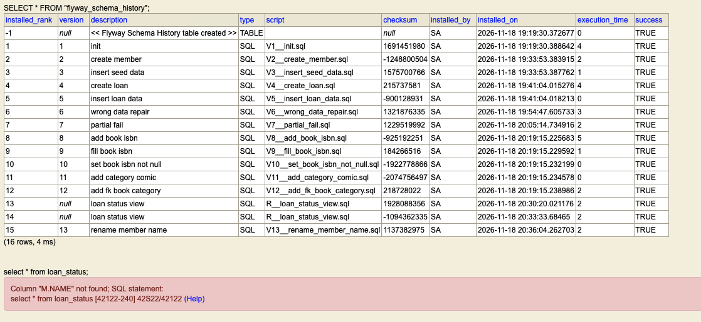

```
Column "M.NAME" not found; SQL statement: select * from loan_status
```

- R__은 **자기 파일이 바뀔 때만** 다시 실행된다. V13이 `MEMBER`를 바꿔도 R__ 파일은 그대로라 뷰는 다시 만들어지지 않았다.
- Flyway는 "전부 성공", 앱도 정상적으로 뜬다. 문제는 **누군가 뷰를 조회하는 순간**에야 드러난다.
- H2는 뷰가 참조하는 컬럼의 이름을 바꿔도 막지 않았다. DB마다 동작이 다르니 DB에 기대지 말고 마이그레이션에서 책임지자.

R__의 `M.NAME`을 `M.MEMBER_NAME`으로 고치면 checksum이 바뀌어 다시 실행된다.

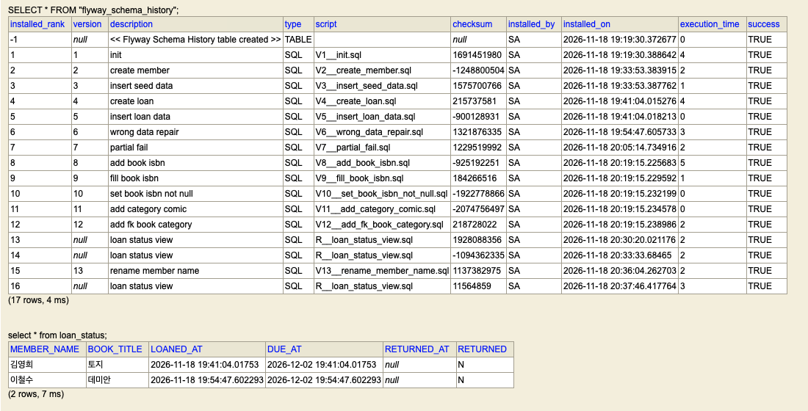

로컬에서는 V13과 R__ 수정이 다른 실행으로 적용돼 잠깐 뷰가 깨져 있었다. 하지만 **두 파일을 한 커밋으로 push하면**, 다른 환경에서는 "V 먼저, R 나중" 순서 덕분에 V13 → R__이 같은 실행에서 연달아 적용되어 뷰가 깨지는 순간이 생기지 않는다.

### R__ 사용 규칙

- 테이블을 바꾸는 V를 추가할 때, 그 테이블을 쓰는 R__도 **같은 커밋에서** 확인한다.
- V__가 R__ 객체에 의존하면 안 된다. 빈 DB에서는 R__이 맨 마지막에 실행된다.
- R__ 파일을 지워도 객체는 남는다. 없애려면 `DROP VIEW`를 하는 V__를 추가한다.

---

## 8. Flyway 없이 운영하던 DB에 도입하기: baseline

별도 프로필로 "Flyway 없이 `schema.sql`로 운영하던 DB"를 만들었다.

```yaml
# application-legacy.yml
spring:
  datasource:
    url: jdbc:h2:file:./h2/legacy;AUTO_SERVER=TRUE
  flyway:
    enabled: false   # 먼저 끄고 띄워서 CATEGORY, BOOK을 손으로 생성
```

테이블을 만든 뒤 Flyway를 켜면:

```
Found non-empty schema(s) "PUBLIC" but no schema history table.
Use baseline() or set baselineOnMigrate to true to initialize the schema history table.
```

```yaml
spring:
  flyway:
    enabled: true
    baseline-on-migrate: true
    baseline-version: 1
```

```
Successfully baselined schema with version: 1
Current version of schema "PUBLIC": 1
Migrating schema "PUBLIC" to version "2 - create member"
...
Migrating schema "PUBLIC" to version "13 - rename member name"
Migrating schema "PUBLIC" with repeatable migration "loan status view"
Successfully applied 13 migrations to schema "PUBLIC", now at version v13
```

이력의 첫 행은 `type = BASELINE`으로 기록되고, V1은 건너뛰고 V2부터 실행된다.

### baseline이 하지 않는 일

baseline은 "이 DB는 V1까지 반영됐다"는 **표시만** 남긴다. 기존 DB가 **정말 V1과 같은 구조인지는 확인하지 않는다.** 그래서 실무에서는 V1을 운영 DB의 실제 스키마를 덤프해서 만드는 게 정석이다.

### 생각해 볼 것

- **`baseline-version: 0`이면?** V1부터 실행되고, `CREATE TABLE CATEGORY`가 "이미 있다"며 실패한다. `baseline-version`은 **기존 DB에 이미 반영된 마지막 버전**이어야 한다.
- **`baseline-on-migrate: true`를 운영에 계속 켜 두면?** 원래 실패시켜 주던 상황을 조용히 통과시킨다. URL을 잘못 설정해 **다른 서비스의 DB**에 붙거나, 누가 실수로 이력 테이블을 지우면, Flyway가 그 DB를 baseline하고 마이그레이션을 실행해 버린다. 도입할 때 **한 번만** 쓰고 지우자. 빈 DB에는 애초에 필요 없다.

---

## 9. JPA 엔티티와 `ddl-auto: validate`

```yaml
spring:
  jpa:
    hibernate:
      ddl-auto: validate
```

```java
@Entity
@Table(name = "MEMBER")
public class Member {

    @Id
    @GeneratedValue(strategy = GenerationType.IDENTITY)
    private Long id;

    @Column(name = "MEMBER_NAME", nullable = false, length = 100)
    private String memberName;

    @Column(nullable = false, unique = true, length = 255)
    private String email;

    @Column(nullable = false)
    private LocalDateTime createdAt;
}
```

필드를 일부러 `NAME`으로 매핑하면:

```
SchemaManagementException: Schema validation: missing column [name] in table [member]
```

### 실행 순서: Flyway → Hibernate

오류는 Hibernate가 냈지만, 실행은 **Flyway가 먼저**다. 앞의 오류 로그에 있던 `Failed to initialize dependency 'flywayInitializer' of ... bean 'entityManagerFactory'`가 그 증거다. Spring Boot는 Hibernate를 Flyway가 끝난 다음에 만들도록 의존 관계를 걸어 둔다. Flyway가 V13까지 성공한 뒤 Hibernate가 완성된 스키마를 검사하다 실패한 것이다.

### `@DataJpaTest`로 검증하기

```java
@DataJpaTest
class BookRepositoryTest {

    @Autowired
    private BookRepository bookRepository;

    @Test
    void saveAndFind() {
        Book saved = bookRepository.save(
                new Book("테스트 도서", "테스트 저자", "TECH", "978-0-00-000000-0"));

        Book found = bookRepository.findById(saved.getId()).orElseThrow();

        assertThat(found.getTitle()).isEqualTo("테스트 도서");
        assertThat(found.getIsbn()).isEqualTo("978-0-00-000000-0");
    }
}
```

- 파일 DB가 아니라 **인메모리 H2**(`jdbc:h2:mem:...`)를 쓴다.
- Flyway가 **빈 DB에 V1~V13 + R__ 전체를** 처음부터 적용한다.
- `validate`이므로 Flyway가 만든 스키마와 엔티티가 일치해야 통과한다.

이 테스트를 CI에서 돌리면 배포 전에 두 가지를 잡을 수 있다.

1. **엔티티와 스키마의 불일치**
2. **빈 DB에서 처음부터 다시 만들 수 있는지.** 로컬 파일 DB는 새 버전만 실행하니 이걸 확인할 기회가 없다.

한계도 있다. 운영 DB가 PostgreSQL이나 MySQL이라면 H2와 문법·동작이 다르다. 실무에서는 Testcontainers로 운영과 같은 DB에서 돌린다.

### 왜 `ddl-auto: update`를 같이 쓰면 안 될까?

- 스키마를 바꾸는 주체가 둘이 된다. Hibernate가 바꾼 내용은 마이그레이션 파일에도 이력에도 남지 않는다.
- 로컬에만 생긴 컬럼 때문에 "내 PC에서는 되는데"가 생긴다.
- 같은 컬럼을 추가하는 V를 뒤늦게 쓰면 로컬 DB에서는 "이미 있다"며 실패한다.
- `update`는 컬럼을 지우거나 이름을 바꾸지 못한다.

**Flyway는 스키마를 만들고, Hibernate는 검사만 한다.**

---

## 정리

| 주제 | 핵심 |
|---|---|
| migrate | 이력에 없는 버전만 순서대로 실행, 시작 시 validate 먼저 |
| 이름 규칙 | 틀리면 조용히 무시됨, `validate-migration-naming: true` |
| 실패 | H2처럼 DDL이 자동 커밋되는 DB는 실패도 기록됨, DDL/DML 분리 |
| repair | 흔적 정리 → repair, 상시 사용 금지 |
| checksum | 적용된 파일은 고치지 않는다, 변경은 새 버전으로 |
| 데이터 변경 | 추가 → 채우기 → 제약, 환경마다 데이터가 다르다는 걸 기억 |
| R__ | checksum이 바뀔 때만 재실행, 관련 V와 같은 커밋에 |
| baseline | 도입 시 한 번만, 버전을 정확히, 구조 일치는 직접 보장 |
| JPA | Flyway가 만들고 Hibernate는 `validate`, 테스트로 전체 재구성 검증 |

개념을 먼저 다 읽고 시작했다면 checksum이나 baseline 옵션은 "그런 게 있구나" 하고 넘어갔을 것 같다. 직접 오류를 내 보고 복구해 보니 **각 기능이 왜 그렇게 설계됐는지**가 훨씬 잘 보였다. 다음에는 같은 시나리오를 Liquibase로 옮겨서 두 도구를 비교해 볼 예정이다.
