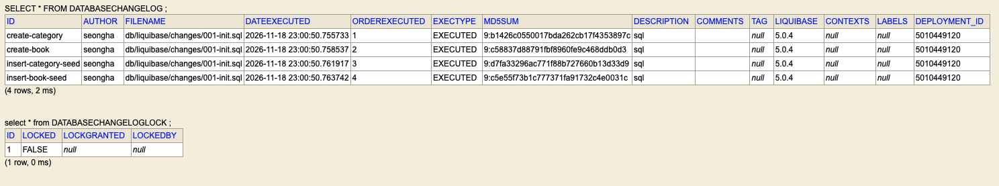
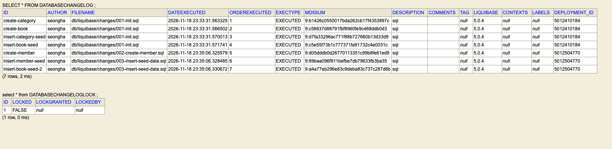
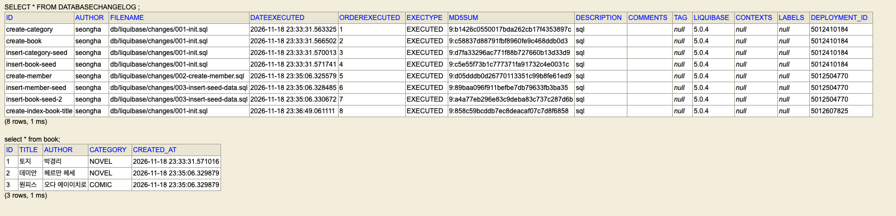
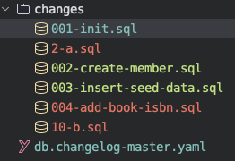
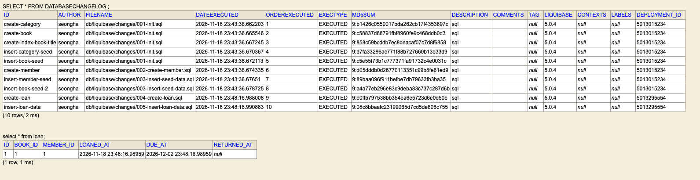
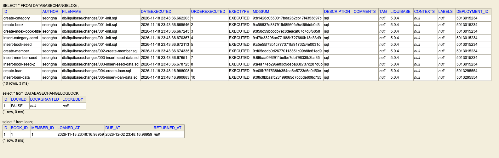
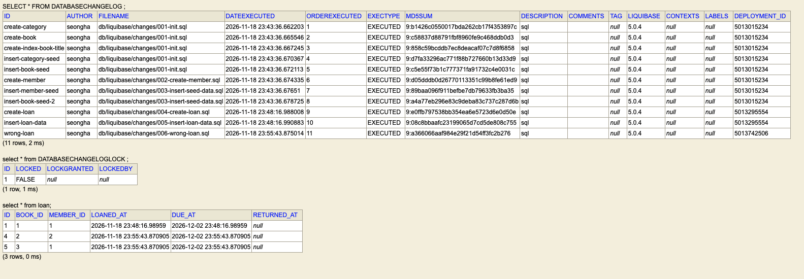
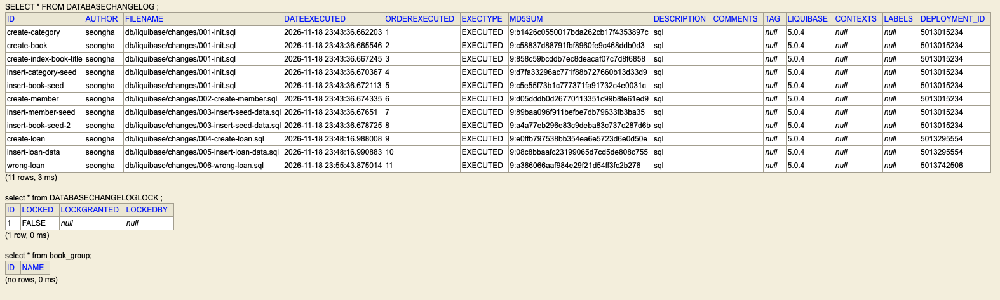
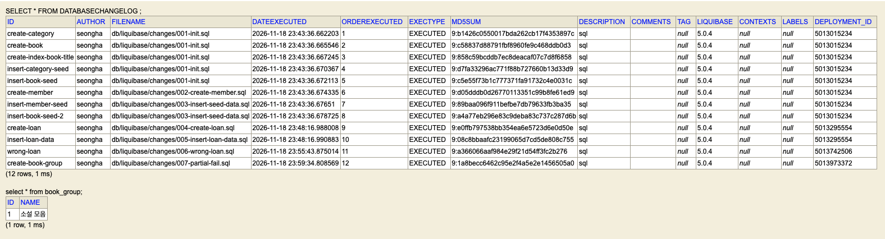

# Spring Boot 4에서 Liquibase 기본 익히기: changeset, 실행 순서, 실패, checksum

> 작은 도서 대여 도메인(BOOK, MEMBER, LOAN)을 만들어 Liquibase의 기본 동작을 하나씩 확인하고, **일부러 실패도 시켜 보면서** 정리한 기록입니다. changelog는 formatted SQL로만 작성했습니다.

## 실습 환경

| 항목 | 버전 |
|---|---|
| Java | 17 |
| Spring Boot | 4.1.2 |
| Liquibase | 5.0.4 (`spring-boot-starter-liquibase`) |
| DB | H2 2.4.240 (file 모드) |

Liquibase 5.0부터 Community 에디션의 라이선스가 Apache 2.0에서 FSL(Functional Source License)로 바뀌었다. FSL은 2년이 지나면 Apache 2.0 또는 MIT로 전환된다. 공식 문서에는 유료 에디션(Liquibase Secure) 기준 설명이 섞여 있어서, `liquibase-secure-starter-all` 의존성이나 라이선스 키 안내는 Community와 관계없다.

## 기본 개념

- 실행과 기록의 단위는 **changeset**이다. 파일 하나에 changeset을 여러 개 둘 수 있다.
- changeset은 **id + author + 파일 경로**로 식별한다.
- 실행 순서는 파일명이 아니라 **master changelog에 적힌 순서**다.
- 이력 테이블은 두 개다. `DATABASECHANGELOG`(적용 이력)와 `DATABASECHANGELOGLOCK`(동시 실행을 막는 락).

## 실습 시나리오

| 파일 | 내용 | 배우는 것 |
|---|---|---|
| 001 | `CATEGORY`, `BOOK` 생성 + 초기 데이터 | changeset, 이력 테이블 |
| 002~003 | `MEMBER` 생성, 회원/도서 데이터 | 실행 순서, include 누락, includeAll |
| 004~005 | `LOAN` 생성(FK 2개), 대여 데이터 | DDL과 DML 분리 |
| 006~007 | 일부러 실패시키기 | 실패한 changeset, 복구, 락 |
| (001 수정) | 적용된 changeset 수정 | checksum |

---

## 1. 설정과 첫 changeset

### 의존성

```kotlin
dependencies {
    implementation("org.springframework.boot:spring-boot-starter-data-jpa")
    implementation("org.springframework.boot:spring-boot-starter-liquibase")
    runtimeOnly("com.h2database:h2")
}
```

### application.yml

```yaml
spring:
  datasource:
    url: jdbc:h2:file:./h2/liquibase;AUTO_SERVER=TRUE
    username: sa
    password:
  jpa:
    hibernate:
      ddl-auto: none
  liquibase:
    change-log: classpath:db/liquibase/db.changelog-master.yaml
```

기본 경로는 `db/changelog/db.changelog-master.yaml`이라 `db/liquibase`를 쓰려면 `change-log`를 지정해야 한다.

### master changelog와 첫 파일

```yaml
# db.changelog-master.yaml
databaseChangeLog:
  - include:
      file: changes/001-init.sql
      relativeToChangelogFile: true
```

```sql
--liquibase formatted sql

--changeset seongha:create-category
CREATE TABLE IF NOT EXISTS CATEGORY ( ... );

--changeset seongha:create-book
CREATE TABLE IF NOT EXISTS BOOK ( ... );

--changeset seongha:insert-category-seed
INSERT INTO CATEGORY ...

--changeset seongha:insert-book-seed
INSERT INTO BOOK ...
```

첫 줄 `--liquibase formatted sql`이 있어야 formatted SQL로 해석된다. 파일 하나에 changeset 4개를 넣었다. 실행과 기록은 파일이 아니라 changeset 단위라서, **changeset 하나에 책임 하나**를 두는 게 기준이 된다.

### 첫 실행 로그

```
Creating database changelog table with name: PUBLIC.DATABASECHANGELOG
Reading from PUBLIC.DATABASECHANGELOG
Successfully acquired change log lock
Using deploymentId: 5010449120
Running Changeset: db/liquibase/changes/001-init.sql::create-category::seongha
ChangeSet db/liquibase/changes/001-init.sql::create-category::seongha ran successfully in 5ms
...
UPDATE SUMMARY
Run:                          4
Previously run:               0
Total change sets:            4
Liquibase: Update has been successful. Rows affected: 4
Successfully released change log lock
```



- 로그의 `파일경로::id::author` 형식이 곧 changeset의 정체성이다. `FILENAME`에는 `classpath:` 없이 classpath 기준 경로가 저장된다.
- `EXECTYPE = EXECUTED`: 성공적으로 실행됐다는 표시다.
- `MD5SUM`은 `9:`로 시작한다. 앞의 숫자는 checksum 계산 방식의 버전이다.
- `DEPLOYMENT_ID`는 한 번의 실행에서 적용된 changeset 묶음이다. 4행 모두 로그의 `deploymentId`와 같다.
- `DESCRIPTION`은 formatted SQL에서는 전부 `sql`이다.
- 락 테이블에는 행이 하나 있고, 실행이 끝나면 `LOCKED = FALSE`로 돌아온다.
- `Rows affected`는 changeset 수가 아니라 DML로 바뀐 행 수다. CREATE INDEX만 실행했을 때는 0이었다.

### 재시작 로그

```
Reading from PUBLIC.DATABASECHANGELOG
Database is up to date, no changesets to execute
UPDATE SUMMARY
Run:                          0
Previously run:               4
```

실행할 changeset이 없으면 **락을 잡지 않는다.** 검증 로그도 보이지 않지만, 4장에서 확인해 보니 checksum 검증은 매번 하고 있었다.

## 2. 실행 순서는 무엇이 정할까

### 정상 추가

`002-create-member.sql`(MEMBER 테이블)과 `003-insert-seed-data.sql`(회원 2명, 데미안·원피스)을 master에 순서대로 include했다.

### include 순서를 번호와 반대로

master에 003을 002보다 위에 적고 빈 DB에서 실행했다.

```
Running Changeset: db/liquibase/changes/001-init.sql::insert-book-seed::seongha
Running Changeset: db/liquibase/changes/003-insert-seed-data.sql::insert-member-seed::seongha
ERROR ... ChangeSet ...::insert-member-seed::seongha encountered an exception.
Run:                          4
Total change sets:            7
Successfully released change log lock
ERROR: Exception Primary Reason:  Table "MEMBER" not found
```

003이 002보다 먼저 실행됐다. 파일명의 숫자는 사람이 보기 위한 것일 뿐, 순서는 changelog가 정한다.

이 실패에서 3장의 내용이 먼저 드러났다.

- **실패한 changeset은 이력에 남지 않는다.**
- 앞서 성공한 001의 changeset 4개는 커밋된 채 남았다(아래 사진의 `DEPLOYMENT_ID 5012410184`). changeset마다 트랜잭션이 따로다.
- 실패해도 락은 해제됐다.
- 순서만 고치고 재시작하니 나머지 3개가 실행됐다. 별도의 복구 명령이 필요 없었다.



### 이미 적용된 파일 중간에 끼워 넣기

001이 적용된 상태에서 `create-book`과 `insert-category-seed` 사이에 `create-index-book-title` changeset을 넣었다.

```
Running Changeset: db/liquibase/changes/001-init.sql::create-index-book-title::seongha
Run:                          1
Previously run:               7
Liquibase: Update has been successful. Rows affected: 0
```



파일상 위치와 상관없이 실행됐고 `ORDEREXECUTED = 8`로 기록됐다. 같은 changelog로 빈 DB에서 처음부터 실행하면 3번째로 실행된다(3장 첫 사진).

**같은 changelog인데 환경마다 실행 순서가 달라진다.** 끼워 넣은 changeset이 파일상 뒤에 있는 것(예: 나중에 추가한 컬럼)에 의존하면, 기존 DB에서는 성공하고 빈 DB에서는 실패한다. **새 changeset은 항상 changelog 맨 끝에 추가한다.**

### include를 빠뜨리면? 조용히 무시된다

`004-add-book-isbn.sql`을 만들고 master에 include하지 않았다.

```
Database is up to date, no changesets to execute
Total change sets:            8
```

파일의 존재 자체를 모른다. 개발자는 추가했다고 생각하지만 아무것도 반영되지 않는다. 폴더의 파일과 changelog를 대조하는 기본 옵션은 보이지 않아서, 리뷰나 CI 스크립트로 막아야 한다.

### includeAll: 문자열 정렬

```yaml
databaseChangeLog:
  - includeAll:
      path: changes/
      relativeToChangelogFile: true
```



```
ChangeSet db/liquibase/changes/004-add-book-isbn.sql::add-book-isbn::seongha ran successfully in 8ms
Running Changeset: db/liquibase/changes/10-b.sql::test-10b::seongha
Running Changeset: db/liquibase/changes/2-a.sql::test-2a::seongha
```

- 누락됐던 004가 실행됐다. 대신 **폴더에 들어온 파일은 전부 실행된다.** 테스트용 `2-a`, `10-b`도 실제로 DB에 적용됐다.
- 순서는 숫자가 아니라 문자열 정렬이라 `10-b`가 `2-a`보다 먼저다. 그래서 `001`처럼 자리수를 맞춘다.
- 001~003은 다시 실행되지 않았다. includeAll로 바꿔도 `FILENAME`이 같은 경로로 잡힌 것으로 보인다.

이후 실습은 명시적 `include`로 돌아가고, DB 파일을 지운 뒤 처음부터 다시 적용했다. 명시적 include는 누락 위험이 있지만 리뷰에서 눈에 보인다.

## 3. 실패하기

LOAN 테이블(`004-create-loan.sql`)과 대여 데이터(`005-insert-loan-data.sql`)를 나눠 넣었다. 테이블 생성(DDL)과 데이터 입력(DML)을 분리하는 게 목적이다.



빈 DB에서 다시 적용했기 때문에 `create-index-book-title`의 `ORDEREXECUTED`가 3이다.

### 없는 도서로 대여하기 (DML만 실패)

```sql
-- 006-wrong-loan.sql
--changeset seongha:wrong-loan
INSERT INTO LOAN (BOOK_ID, MEMBER_ID, DUE_AT)
VALUES (2, 2, DATEADD('DAY', 14, CURRENT_TIMESTAMP));   -- 정상
INSERT INTO LOAN (BOOK_ID, MEMBER_ID, DUE_AT)
VALUES (999, 1, DATEADD('DAY', 14, CURRENT_TIMESTAMP)); -- FK 위반
```



- 이력에 `wrong-loan` 행이 없다. 락도 풀려 있다.
- LOAN에는 1번 행만 있다. 정상이던 첫 번째 INSERT도 같이 롤백됐다. **한 changeset 안의 DML은 함께 롤백된다.**

999를 3으로 고치고 재시작하니 바로 성공했다.

```
Running Changeset: db/liquibase/changes/006-wrong-loan.sql::wrong-loan::seongha
Run:                          1
Previously run:              10
Liquibase: Update has been successful. Rows affected: 2
```



- 새 행의 ID가 2, 3이 아니라 **4, 5**다. 실패한 실행에서 ID 2, 3이 발급됐다가 롤백된 것이다. 행은 사라져도 AUTO_INCREMENT 값은 되돌아가지 않는다.
- 이력의 `MD5SUM`은 처음부터 고친 파일 기준이다. 실패 기록이 없으니 비교할 대상도 없다. **실패한 changeset은 고쳐서 다시 실행하면 된다.**

### 중간까지 적용된 실패 (DDL + DML)

```sql
-- 007-partial-fail.sql
--changeset seongha:create-book-group
CREATE TABLE BOOK_GROUP
(
    ID   BIGINT AUTO_INCREMENT PRIMARY KEY,
    NAME VARCHAR(100) NOT NULL
);
INSERT INTO BOOK_GROUP (NAME) VALUES (NULL);  -- NOT NULL 위반
```



이력에는 아무것도 없는데 `BOOK_GROUP` 테이블은 남았다. INSERT는 롤백됐지만 CREATE TABLE은 H2에서 자동 커밋됐다.

INSERT만 고쳐서 다시 실행하면 이렇게 된다.

```
Caused by: org.h2.jdbc.JdbcSQLSyntaxErrorException: Table "BOOK_GROUP" already exists
```

**이전에 실패했다는 단서가 없다.** 이력에는 아무것도 없고 DB 에러만 있다. 흔적이 남았다는 건 사람이 에러 메시지로 추론해야 하고, 실패 당시 로그가 없으면 DB 어디에도 단서가 없다.

`IF NOT EXISTS`를 붙이는 건 답이 아니다. 이 문제는 내 로컬 DB에만 있고, 남은 테이블이 의도와 다른 구조여도 그냥 통과시켜 버린다. **changeset이 아니라 DB를 고친다.**

```sql
DROP TABLE BOOK_GROUP;
```

재시작하면 바로 성공한다.



그래서 **한 changeset에 DDL과 DML을 섞지 말자.** DDL은 changeset 하나에 문장 하나가 안전하다. 문장이 하나면 실패할 때 아무것도 남지 않고, 성공하면 기록된다.

### 락이 남는 경우 (직접 재현하지 않음)

- 시작할 때 `DATABASECHANGELOGLOCK`의 한 행을 `LOCKED = TRUE`로 바꿔 락을 잡는다. `LOCKEDBY`에는 호스트명과 IP가 기록된다.
- 못 잡으면 `Waiting for changelog lock....`을 찍으며 기다리고, 기본 5분이 지나면 시작이 실패한다.
- 정상 종료나 실패 때는 finally에서 푼다. 하지만 `kill -9`, OOM, SIGKILL처럼 정리할 기회가 없으면 **락이 남는다.** 만료 시간이 없어서 이후 배포가 계속 막힌다.
- 실행할 changeset이 없으면 락을 잡지 않으니(1장 재시작 로그), 남은 락은 다음에 마이그레이션이 있는 배포에서야 드러날 수 있다(추론).
- 풀기 전에는 `LOCKEDBY`와 `LOCKGRANTED`로 대상을 찾고, 그 프로세스가 살아 있는지와 DB 세션(`pg_stat_activity` 등)을 확인한다. 그다음 `releaseLocks`나 UPDATE로 푼다.

## 4. 적용된 changeset을 고치면?

이미 적용된 changeset을 바꾸고 재시작했다. 실험이 끝날 때마다 원래대로 되돌렸다.

| 실험 | 변경 | 결과 |
|---|---|---|
| a | 빈 줄, 공백, 들여쓰기 | 통과 |
| b | changeset 안에 SQL 주석 `-- 메모` | checksum 불일치로 시작 실패 |
| c | INSERT 값 변경 | 시작 실패 |
| d | 파일 맨 끝(changeset 밖)에 주석 | 시작 실패 |

- 실행할 게 없는 재시작에서도 실패했다. 로그에 안 찍힐 뿐 **매번 checksum을 검증한다.**
- a가 통과한 건 checksum을 계산할 때 공백을 정규화하기 때문으로 보인다.
- d는 formatted SQL의 규칙 때문이다. `--changeset` 줄부터 다음 `--changeset` 줄 전까지가 한 changeset이라, 파일 끝 주석은 마지막 changeset의 내용이 된다. 파일 끝에 메모를 남기지 말자.

**적용된 changeset은 고치지 않고, 바꾸고 싶은 건 새 changeset으로 추가한다.**

## 다루지 않은 것

formatted SQL만 썼기 때문에 Liquibase의 다른 기능은 다루지 않았다.

- YAML/XML change type으로 DB에 독립적인 changelog 작성
- rollback, tag
- `runOnChange` / `runAlways` (반복 실행)
- contexts / labels (환경별 changeset 선택)
- precondition
- 기존 DB에 도입하기 (`generateChangeLog`, `changelogSync`)
- checksum 대응 방법 (`validCheckSum`, `clear-checksums`)

## 정리

- 실행 단위는 changeset, 정체성은 `파일경로::id::author`, 순서는 changelog가 정한다.
- 새 changeset은 항상 changelog 맨 끝에 추가한다. 중간에 끼우면 환경마다 실행 순서가 달라진다.
- include를 빠뜨리면 조용히 무시된다. includeAll은 폴더의 모든 파일을 문자열 순서로 실행한다.
- 실패한 changeset은 기록되지 않는다. 고쳐서 다시 실행하면 되지만, DDL이 남긴 흔적은 사람이 찾아야 한다.
- 한 changeset에 DDL과 DML을 섞지 않는다.
- 적용된 changeset은 고치지 않는다. 공백은 허용되지만 주석 한 줄은 변경으로 본다.
